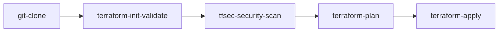
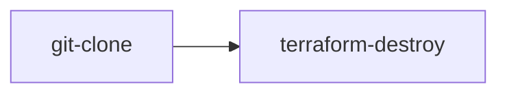

# EKS Cluster Infrastructure: cluster-lunedi

This repository manages the production AWS Elastic Kubernetes Service (EKS) cluster **`cluster-lunedi`** located in **`eu-west-1`**, provisioned via Terraform and continuously managed by Tekton CI/CD pipelines.

## Architectural Summary

- **Cluster Name**: `cluster-lunedi`
- **AWS Region**: `eu-west-1`
- **Kubernetes Version**: `1.37`
- **VPC (existing, not created here)**: `vpc-04f3bbc90663bf4d7` — the cluster attaches to the shared platform VPC and its subnets. Terraform only *reads* the network, so destroying this stack removes the cluster, node groups and add-ons but never the VPC.
- **Worker Compute**: AWS Managed Node Group (`m6i.large`), autoscaling between 2 and 6 nodes.
- **Control Plane Security**: Dedicated KMS Customer Managed Key with envelope encryption on Kubernetes secrets.
- **Mandatory Ownership Contract**: Every AWS resource this stack creates (Control Plane, Node Groups, Launch Templates, EC2 instances, EBS volumes, KMS key, IAM roles, Security Groups, add-on IAM roles) is tagged:
  ```hcl
  Owner = "so.amin"
  ```
  The shared VPC and its subnets are **not** retagged or modified — they belong to another stack and other clusters use them.

---

## Directory Structure

```tree
.
├── .tekton/
│   ├── destroy-pipeline.yaml    # Teardown pipeline: git-clone -> terraform-destroy
│   ├── destroy-pipelinerun.yaml # Manual teardown run spec
│   ├── pipeline.yaml            # Orchestrates clone -> validate -> security scan -> plan -> apply
│   ├── pipelinerun.yaml    # Manual/test execution spec with gp3 PVC workspace
│   ├── tasks.yaml               # Tekton Tasks: terraform-init-validate, tfsec, plan, apply, destroy
│   └── triggers.yaml       # GitHub push EventListener, TriggerBinding, and TriggerTemplate
├── catalog-info.yaml       # Backstage Component and Resource descriptor
└── terraform/
    ├── addons.tf           # AWS Load Balancer Controller, Metrics Server, ExternalDNS, Tekton
    ├── backend.tf          # S3 Remote State & DynamoDB Lock configuration
    ├── eks.tf              # EKS Control plane, Managed Node Group & KMS envelope encryption
    ├── outputs.tf          # Cluster endpoints, CA data, VPC IDs and security groups
    ├── provider.tf         # AWS, Kubernetes, and Helm provider definitions with default_tags
    ├── variables.tf        # Input variable definitions
    └── vpc.tf              # Read-only lookups for the existing VPC and subnets
```

## Attaching to an existing VPC

`terraform/vpc.tf` does not create networking. It resolves the VPC and subnets you
select and fails the plan early if they are inconsistent:

| Variable | Default | Notes |
|---|---|---|
| `vpc_id` | `vpc-04f3bbc90663bf4d7` | shared platform VPC, owned outside this stack |
| `vpc_private_subnet_ids` | one per AZ in `eu-west-1` | control plane ENIs and worker nodes |
| `vpc_public_subnet_ids` | one per AZ in `eu-west-1` | internet-facing ALBs |

Checks enforced at plan time:

- every subnet must belong to `vpc_id`;
- every subnet must be in `aws_region`;
- at most one private subnet per Availability Zone, and at least two AZs.

Because the subnets are shared with other clusters, worker subnets must already
carry `kubernetes.io/role/internal-elb` and public ones `kubernetes.io/role/elb`.
Nodes in private subnets also need egress (NAT gateway or VPC endpoints) to pull
images and reach the EKS API.

---

## Tekton Provisioning Pipeline

The infrastructure workflow is automated via Tekton:



### Automatic Triggering on Git Push

Pushing commits to the `main` branch automatically invokes the `EventListener` defined in `.tekton/triggers.yaml`.

To expose the EventListener sink to GitHub:
```bash
kubectl -n bs-team-alpha-dev port-forward service/el-cluster-lunedi-listener 8080:8080
```
Configure your GitHub repository webhook:
- **Payload URL**: `http://<your-ingress-or-tunnel-host>/`
- **Content type**: `application/json`
- **Events**: Just the `push` event.

### Manual Pipeline Run

You can trigger a manual run with `kubectl`:
```bash
kubectl create -f .tekton/pipelinerun.yaml
```


---

## Tekton Teardown Pipeline (Destroy)

When decommissioning the cluster, the teardown pipeline safely tears down the EKS control plane, node groups, KMS keys, and Helm add-ons, leaving the shared platform VPC (`vpc-04f3bbc90663bf4d7`) and its subnets intact:



### Manual Teardown Run

To trigger an explicit teardown run:
```bash
kubectl create -f .tekton/destroy-pipelinerun.yaml
```

> [!WARNING]
> This permanently destroys the EKS cluster and worker nodes. The shared platform VPC and subnets are read-only and preserved untouched.
